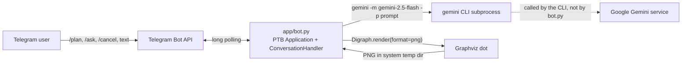

# MindmapAI - documentation hub

MindmapAI is a Telegram bot written in Python (`app/bot.py`). The `/plan` command
takes free text, asks the Gemini CLI to extract a list of tasks with short labels,
and returns a PNG diagram drawn with Graphviz. If Graphviz is missing, it returns a
text list instead. The `/ask` command passes the text to the Gemini CLI unchanged and
sends the answer back. The repository does not say who the intended users are (see
[Open questions in SPEC.md](../SPEC.md#9-open-questions)).

## 1. Status

- Branch described: `dev` at commit `c40f7e5`. Its last commit was on 2026-08-05
  ("docs: add an MIT licence naming the author", `git log -1`). The branch has 8 commits,
  the first on 2025-10-15.
- History, from commit messages (`git log`):
  - v1.0.0 to v1.0.2 were written in Haskell (`app/Main.hs`, `haskell-gemini-bot.cabal`).
    v1.0.0 only relayed text to Gemini; v1.0.1 added Mermaid diagram text, and v1.0.2
    rendered it to PNG with `mmdc`.
  - v2.0.0 "no haskell" (847e0fd) replaced that code with `app/bot.py` and Graphviz.
  - v2.1.0 (5786627) is the last code change on this branch.
- Tests: none. CI: none. There is no `tests/`, `.github/` or `.gitea/` in this checkout.
- TODO/FIXME/XXX/HACK markers: 0 (`grep -rnE 'TODO|FIXME|XXX|HACK'`).
- Another branch, `origin/release` (the remote's default, `origin/HEAD -> origin/release`),
  is at `86c70c0` from 2026-11-08 ("revision 4.0.0").
  - It contains `c40f7e5` as an ancestor.
  - `git diff --stat origin/dev origin/release` shows 34 changed files, among them
    `tests/test_bot.py`, `.gitea/workflows/*.yaml`, `docs/install.md`, `docs/manual.md`,
    `pyproject.toml`, `uv.lock` and `CLAUDE.md`.
  - **None of that is in this checkout, and this document does not describe it.**
- Visibly unfinished on `dev`:
  - `gemini-cli-install.sh` still installs Mermaid, which the Python bot does not use.
  - `bot.py` has unused imports.
  - The README's project tree does not match the files (see section 8).

## 2. Layout

| Path | What it is |
|---|---|
| `app/bot.py` | The whole bot: Gemini CLI calls, Graphviz rendering, Telegram handlers, entry point (412 lines) |
| `requirements.txt` | Python dependencies, unpinned except `python-telegram-bot[job-queue]>=20.0` |
| `gemini-cli-install.sh` | Shell script: installs `@google/gemini-cli` and `@mermaid-js/mermaid-cli` with npm if missing, plus `chrome-headless-shell` via puppeteer |
| `README.md` | Project README: features, prerequisites, setup, commands |
| `LICENSE` | MIT License |
| `.gitignore` | Ignores `.env`, `chrome-headless-shell/` and the Haskell/cabal build outputs `dist-newstyle/` and `cabal-project.local` |
| `.vscode/settings.json` | Editor setting: excludes `**/target` from the file watcher |

## 3. Architecture

A single process runs `python-telegram-bot` (PTB) long polling (`app/bot.py:401`).
- One `ConversationHandler` (`app/bot.py:373-387`) holds two states:
  `WAITING_PLAN_MINDMAP` and `WAITING_QUESTION`.
- A separate `MessageHandler` answers text sent outside a conversation (`app/bot.py:391-396`).
- An error handler sends an apology to the chat (`app/bot.py:306-317`).
- The bot reaches Gemini by spawning the `gemini` executable with
  `gemini -m gemini-2.5-flash -p <prompt>`. There is no shell, and the bot opens no
  HTTP connection to Gemini itself (`app/bot.py:107-124`).
- Diagrams come from the `graphviz` Python package, which calls the `dot` binary
  (`app/bot.py:45-60`, `app/bot.py:83`).



`/plan` data flow:
1. The user's text is embedded in a fixed extraction prompt (`app/bot.py:136-155`).
2. The Gemini CLI output is parsed line by line as `task | label` (`app/bot.py:165-175`).
3. The pairs become numbered box nodes. Each node gets one edge to the next, which makes
   a linear chain, not a tree (`app/bot.py:48-58`).
4. The chain is rendered to a temporary PNG, sent with `send_photo`, and deleted
   (`app/bot.py:80-103`).

Nothing is stored on disk except these temporary files. Conversation state lives only in
memory.

## 4. Build and run

Prerequisites (from `README.md`):

| Component | Version / source | Install command (source) |
|---|---|---|
| Python | 3.8+ (`README.md:21`) | - |
| Gemini CLI (`gemini` on PATH) | `@latest`, unpinned | `npm install -g @google/gemini-cli@latest` (`README.md:24`, `gemini-cli-install.sh:6`) |
| Graphviz (`dot` on PATH), optional | not pinned | `sudo apt install graphviz` or `brew install graphviz` (`README.md:26`) |
| npm | not stated | needed by the command above |

The README's "Python 3.8+" may not match what pip installs:
- `requirements.txt` sets only a lower bound for PTB.
- The PTB 22.6 found on this machine declares `Requires-Python: >=3.10` (its installed
  `METADATA`).
- So the PTB version pip picks depends on the interpreter. Which Python is actually
  supported is not stated anywhere.

Install (from `README.md:47-51`):

```bash
python3 -m venv venv
source venv/bin/activate  # On Windows, use 'venv\Scripts\activate'
pip install -r requirements.txt
```

Run (from `README.md:86`):

```bash
python app/bot.py
```

`gemini-cli-install.sh` is listed in `README.md:112` as a helper script. The repository
gives no command to run it. The script has no shebang line, and its syntax is bash
(the `&>` redirection).

## 5. Configuration

| Name | Kind | Meaning | Default | Source |
|---|---|---|---|---|
| `TELEGRAM_BOT_TOKEN` | env var, usually in `.env` | Telegram bot token | none; if missing, the bot logs an error and does not start polling | `app/bot.py:350-355`, `README.md:69` |
| `.env` | file, ignored by git | Loaded by `load_dotenv()` at startup | - | `app/bot.py:326`, `.gitignore:1` |
| `gemini` on `PATH` | executable | Required; without it `main()` returns before polling | - | `app/bot.py:329-335` |
| `dot` on `PATH` | executable | Optional; without it `/plan` answers with text | - | `app/bot.py:340-347`, `app/bot.py:236-240` |
| `GEMINI_MODEL` | constant in code | Model passed to `gemini -m` | `gemini-2.5-flash` | `app/bot.py:30` |
| Telegram HTTP timeouts | constants in code | connect 60 s, read 300 s, write 300 s | as stated | `app/bot.py:363-365` |

Notes:
- `bot.py` has no command-line flags; nothing parses arguments.
- Where `.env` is found: python-dotenv 1.1.0 (installed on this machine) starts searching
  from the calling file's directory (`app/`) and walks up. This means a `.env` at the
  repository root is found whatever the working directory. This comes from reading
  `dotenv/main.py:276-315`, not from a run.
- Gemini CLI authentication is not configured anywhere in this repository. Inference:
  - `load_dotenv()` does not override existing variables (`override=False`).
  - The subprocess is started without `env=`, so it inherits the bot's environment,
    including variables loaded from `.env`.
  - How the CLI is meant to authenticate is an open question.

## 6. Usage

| Step | User sends | Bot replies (source) |
|---|---|---|
| 1 | `/plan` | "What is your plan? (for mind-map generation) Send /cancel to stop." (`app/bot.py:197-199`) |
| 2 | free text, e.g. the prompt's own example `go to the store, buy milk, walk the dog, eat lunch, work project (deadline)` (`app/bot.py:143`) | a status message, then "Generating diagram..." and a PNG chain of boxes labelled with Gemini's short labels (`app/bot.py:223-235`, `app/bot.py:75-90`) |
| 2, no `dot` | same | "Tasks filtered (Graphviz 'dot' not found, sending as text):" and lines `- <task> (<label>)` (`app/bot.py:238-240`) |
| 2, no tasks or Gemini failed | same | "Could not find any relevant tasks in your plan. Please try rephrasing." (`app/bot.py:243-246`) |
| - | `/ask`, then a question | "What is your question?" then Gemini's stdout, or "An error occurred: <stderr>" (`app/bot.py:208-210`, `app/bot.py:266-274`) |
| - | `/cancel` inside a conversation | "Action cancelled." (`app/bot.py:284`) |
| - | any other text outside a conversation | "I'm not sure what you mean. Please use /plan to create a mind map or /ask to ask a question." (`app/bot.py:301`) |

What Gemini returns depends on the model, so the exact diagram for a given input is not
fixed by the code.

## 7. Testing

This checkout has no automated tests, no test configuration and no CI. The only checks
are manual, by running the bot against a real Telegram bot token and a working Gemini
CLI. [SPEC.md, section 8](../SPEC.md#8-acceptance) lists the manual checks, one per
requirement group. A test suite (`tests/test_bot.py`, `tests/manual/`) exists only on
`origin/release`.

## 8. Known limitations and problems

Read from the code. Items marked *inference* were not reproduced by running the bot.

1. **Misleading error message.** On `/plan`, if the Gemini CLI fails (non-zero exit or
   empty output), the user is told the plan contains no relevant tasks and should be
   rephrased. The real cause, the CLI's stderr, appears only in the log
   (`app/bot.py:159-161`, `app/bot.py:241-246`).
2. **Restart loop with no pause.** When `gemini` or `TELEGRAM_BOT_TOKEN` is missing,
   `main()` returns. The `while True` loop then calls it again at once, so the process
   writes the same error to the log endlessly without pausing (`app/bot.py:330-335`,
   `app/bot.py:351-355`, `app/bot.py:404-406`).
3. **Ctrl+C probably does not stop the bot.**
   - What I read: in PTB 22.6, `run_polling` catches `KeyboardInterrupt`/`SystemExit`
     itself, returns normally, and closes the event loop (`telegram/ext/_application.py`,
     `__run`, lines 1063-1084).
   - Inference: `bot.py`'s `except KeyboardInterrupt` (`app/bot.py:407`) is then not
     reached, and `main()` runs again. The second run will probably fail on the closed
     loop and retry every 15 s (`app/bot.py:410-412`).
   - Not run; the behaviour depends on the PTB version, which is unpinned.
4. **No time limit on Gemini calls.** `process.communicate()` is awaited without a
   timeout (`app/bot.py:117`). Inference: PTB 22.6 handles one update at a time by default
   (`SimpleUpdateProcessor(max_concurrent_updates=1)` in `_applicationbuilder.py`), and
   `bot.py` does not change that, so a hung CLI call stalls the bot for every chat.
5. **Long answers.** `/ask` sends the whole answer in one message (`app/bot.py:271-274`).
   Inference: Telegram's Bot API limit is 4096 characters per message, per its
   documentation (not checked here). Longer answers would then fail and reach the generic
   "Sorry, an internal error occurred..." handler (`app/bot.py:306-317`).
6. **No `/start` handler.** Telegram clients send `/start` first. The bot does not reply
   to it: no `CommandHandler('start')` exists, and the general handler excludes commands
   (`app/bot.py:373-396`).
7. **Conversations never time out.** No `conversation_timeout` is set
   (`app/bot.py:373-387`; the PTB default is `None`). Inference from PTB defaults
   (`allow_reentry=False`): while the bot is waiting for input, a second `/plan` or `/ask`
   gets no reply.
8. **Non-text messages get no reply.** Photos, voice and other non-text messages are
   ignored, because every message handler filters on `filters.TEXT`.
9. **The "mind map" is a linear chain.** Each task points to the next one
   (`app/bot.py:49`). The full task text is kept only as the Graphviz `tooltip` attribute
   (`app/bot.py:55`). Inference: PNG output does not display tooltips.
10. **No access control.** Any Telegram user who finds the bot can use it, and so use up
    the Gemini quota. The handlers contain no user filter.
11. **Logs contain user content.** At INFO level the log holds the full user text and
    Gemini's raw output (`app/bot.py:134`, `app/bot.py:163`).
12. **Internals reach the user.** Exception texts and CLI stderr are sent to the chat
    (`app/bot.py:96`, `app/bot.py:268`).
13. **Leftover dependencies and imports.**
    - `requirements.txt` lists `httpx` and the `job-queue` extra. `bot.py` imports
      `httpx` but never uses it, and uses no JobQueue.
    - Other unused imports: `re`, `partial`, `reduce`, `ParseMode`, `Application`
      (`app/bot.py:9-27`).
14. **Install script checks the wrong name.**
    - `gemini-cli-install.sh:18-33` installs Mermaid CLI and a headless Chrome. The
      Python bot uses neither.
    - The script tests for a `mermaid` command. The old Haskell version looked up `mmdc`
      instead (`git show 7b7dda9:app/Main.hs`, line 166).
    - Inference: after a successful install, the check still reports failure and exits 1.
      The script was not run.
15. **No lock file.** All dependencies except PTB's lower bound are unpinned.
16. **README project tree is out of date.** It lists `.env`, which is not tracked, and
    omits `LICENSE` and `.vscode/` (`README.md:105-115`).

## 9. Related documents

- [Project README](../README.md): features, setup, commands, written by the author.
- [SPEC.md](../SPEC.md): requirements specification reverse-engineered from `app/bot.py`.
- [LICENSE](../LICENSE): MIT.
- [requirements.txt](../requirements.txt) and
  [gemini-cli-install.sh](../gemini-cli-install.sh).
- `docs/install.md` and `docs/manual.md` exist only on `origin/release` and are not
  linked here.

## 10. About this document

Written on 2026-11-18 from commit `c40f7e5` (branch `dev`).

Commands run to check it, all read-only:
- `git status -sb`, `git log`, `git ls-files`, `git branch -a`
- `git diff --stat origin/dev origin/release`, `git merge-base --is-ancestor`
- `git show 7b7dda9:app/Main.hs`
- `grep -rnE 'TODO|FIXME|XXX|HACK'`
- a syntax parse of `app/bot.py` with `ast.parse`
- import/version probes: PTB 22.6 and python-dotenv 1.1.0 are installed; the `graphviz`
  package is not
- `command -v gemini dot mmdc mermaid`: none found on this machine
- reading the installed PTB and python-dotenv sources

Not run:
- the bot itself
- `pip install`
- `gemini-cli-install.sh`
- any network call (there are no tests to run)

Statements about runtime behaviour therefore come from reading code. Those that depend
on library internals are marked as inference.
